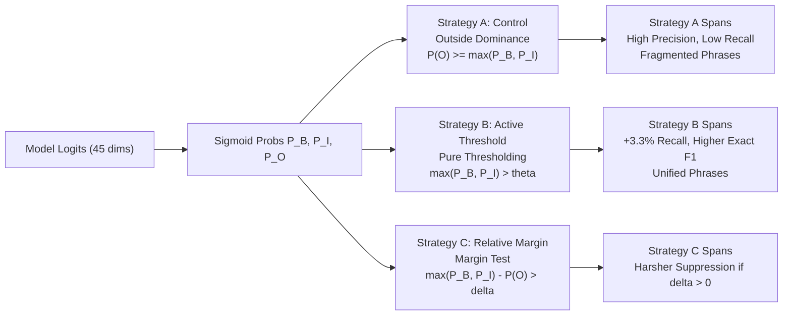

# Evernorth Track B — Experiment 2.1: BIO Decoder Ablation Report

**Project:** Evernorth Clinical Decision Support (CDS) Research Prototype  
**Track:** Track B — Social & Behavioral Determinants of Health (SBDH) Extraction  
**Experiment:** Experiment 2.1 — BIO Decoder Ablation (Inference-Only)  
**Date:** October 2026  
**Status:** Educational & Research Prototype — Not for Direct Clinical Use  
**Artifact Directory:** [`reports/experiments/decoder_ablation/`](../../../reports/experiments/decoder_ablation/)  
**Metrics JSON:** [`reports/experiments/decoder_ablation/decoder_ablation_metrics.json`](../../../reports/experiments/decoder_ablation/decoder_ablation_metrics.json)  

---

> [!CAUTION]
> **MANDATORY REGULATORY & CLINICAL DISCLAIMER:**  
> This decoder ablation experiment investigates token-level BIO sequence decoding algorithms on synthetic clinical narratives strictly for computational linguistics and machine learning evaluation. The models, decoders, and prototype interfaces are **not FDA-cleared medical devices** and must **never** be used for clinical diagnosis, patient triage, care authorization, or medical decision-making.

---

## 1. Executive Summary

In Experiment 1, diagnostic token audits revealed that the production BIO sequence decoder contains an Outside-dominance suppression clause:
$$\text{Token } t \text{ is Outside } (O) \iff P(O) \ge \max(P_B, P_I) \quad \text{OR} \quad \max(P_B, P_I) \le \theta$$
Because non-entity tokens heavily dominate clinical text, the background prior $P(O)$ regularly hovers between $0.50$ and $0.65$ even when an active SBDH mention is present with high confidence ($P_I \in [0.35, 0.45]$). This rule unconditionally suppresses valid predictions where the model's entity probability exceeds the operating threshold ($\theta = 0.30$) but does not exceed $P(O)$, leading to false negatives on challenging categories (e.g., `barriers to care`, `physical isolation`) and fragmenting multi-word phrases across grammatical connectives.

In **Experiment 2.1**, we conducted a controlled, inference-only ablation comparing three decoder strategies across all **876 validation notes** (`synth_sbdh_val.csv`, 1,443 gold annotations) using the frozen 3-epoch Colab checkpoint (`best_model.pt`):

1. **Strategy A (Control — Production Outside-Dominance Decoder):**  
   Replicates the existing production decoder. Achieves **Exact F1 of 0.5071** and **Relaxed F1 of 0.8319** (Recall: 0.8503, Precision: 0.8142) at $\theta = 0.30$.
2. **Strategy B (Active-Threshold Decoder):**  
   Allows B/I entity predictions whenever $\max(P_B, P_I) > \theta$, without requiring entity probabilities to exceed $P(O)$.  
   - At $\theta = 0.30$, Strategy B improves **Exact F1 to 0.5195** (+0.0124) and **Relaxed F1 to 0.8342** (+0.0023), driving Relaxed Recall from 0.8503 to **0.8836 (+3.33% absolute recall gain)** while maintaining strong precision (0.7900).
   - At $\theta = 0.40$, Strategy B achieves **Relaxed F1 of 0.8350** with high precision (0.8138) and recall (0.8572).
   - Recovers key suppressed categories: `physical isolation` recall jumps from **0.3043 to 0.3913 (+8.70%)**, `barriers to care` recall jumps from **0.6333 to 0.6833 (+5.00%)**, and `transitions of care` recall jumps from **0.7073 to 0.7805 (+7.32%)**.
   - On the Experiment 1 synthetic narrative, Strategy B successfully extracts **7 spans across 3 categories** (including `"could not arrange transportation"` and `"refill her prescriptions"` as `barriers to care`) and unifies `"worried about paying her rent and utility bills"` into a single continuous span.
3. **Strategy C (Relative-Margin Decoder):**  
   Requires $\max(P_B, P_I) - P(O) > \text{margin}$. Positive margins ($+0.05, +0.10$) severely degrade performance (Relaxed F1 drops to 0.8273 and 0.8195; Exact F1 drops to 0.5031 and 0.4988) by exacerbating Outside-dominance suppression.

---

## 2. Checkpoint & Environment Identity

This experiment is strictly inference-only. Model weights, baseline manifests, and the production Streamlit decoder in `src/transformer_dataset.py` were **not modified**.

| Component | Specification | Verification Status |
|---|---|:---:|
| **Model Checkpoint** | local-only artifact, not committed to the repository | **VERIFIED** |
| **Initial Checkpoint SHA-256** | `0cb00010631b089746fdd97ff3f9019e1bcc29012a7c093b33501a9c30186ba4` | **VERIFIED** |
| **Final Checkpoint SHA-256** | `0cb00010631b089746fdd97ff3f9019e1bcc29012a7c093b33501a9c30186ba4` | **VERIFIED (BITWISE IDENTICAL)** |
| **Backbone Architecture** | `distilbert/distilroberta-base` (82M parameters, 6 layers, 768 hidden) | **VERIFIED** |
| **Output Head** | 45 independent binary sigmoid logits (15 SBDH categories $\times$ 3 BIO states) | **VERIFIED** |
| **Experimental Module** | [`src/experimental_decoders.py`](../../../src/experimental_decoders.py) | **CREATED (SEPARATE FROM PRODUCTION)** |
| **Runner Script** | [`scripts/run_decoder_ablation.py`](../../../scripts/run_decoder_ablation.py) | **VERIFIED & REPRODUCIBLE** |
| **Validation Dataset** | `synth_sbdh_val.csv` ($N = 876$ notes, 1,443 gold annotations) | **VERIFIED** |
| **Reviewed Test Set** | `synth_sbdh_test_reviewed.csv` ($N = 1,732$ notes) | **EXCLUDED (ZERO TEST LEAKAGE)** |

---

## 3. Decoder Strategy Formulations

Every decoder evaluated shares the identical upstream pipeline:
1. `distilroberta-base` tokenization with FastTokenizer character offset mappings.
2. Identical forward pass logits ($876 \times \text{seq\_len} \times 45$).
3. Identical subword whitespace boundary trimming.
4. Identical Kuhn's Maximum Bipartite Matching for 1-to-1 evaluation.



### Strategy A: Current Production Decoder (Control)
```python
# Outside Condition
if p_o >= max(p_b, p_i) or max(p_b, p_i) <= threshold:
    close_and_emit_open_span()
elif p_b >= p_i:
    start_new_span_beginning()
else:
    continue_span_or_repair_orphan_i()
```

### Strategy B: Active-Threshold Decoder
```python
# Outside Condition: Depends ONLY on active entity probabilities meeting threshold
if max(p_b, p_i) <= threshold:
    close_and_emit_open_span()
elif p_b >= p_i:
    start_new_span_beginning()
else:
    continue_span_or_repair_orphan_i()
```
*Rationale:* In independent multi-label sigmoid classification, $P(O)$ is an uncalibrated third channel. Because non-entity tokens dominate training notes, $P(O)$ has a strong prior baseline. Strategy B decouples entity detection from background class dominance.

### Strategy C: Relative-Margin Decoder
```python
# Outside Condition: Fails threshold OR fails relative margin against P(O)
if max(p_b, p_i) <= threshold or (max(p_b, p_i) - p_o) <= margin:
    close_and_emit_open_span()
elif p_b >= p_i:
    start_new_span_beginning()
else:
    continue_span_or_repair_orphan_i()
```
*Rationale:* Enforces a continuous margin $\delta$. Evaluated at $\delta \in \{0.00, +0.05, +0.10\}$ and diagnostic negative margins $\delta \in \{-0.05, -0.10\}$.

---

## 4. Full Validation Set Benchmark Comparison ($N = 876$ Notes)

Evaluated across all 876 validation notes (1,443 gold annotations) using exact character matching and Kuhn's order-invariant Maximum Bipartite Matching:

| Decoder Strategy | Threshold ($\theta$) | Margin ($\delta$) | Total Preds | Exact TP | Exact FP | Exact FN | Exact F1 | Relaxed TP | Relaxed FP | Relaxed FN | Relaxed Precision | Relaxed Recall | Relaxed F1-Score | Boundary Errors | Boundary Error % | Runtime (s) |
|---|:---:|:---:|:---:|:---:|:---:|:---:|:---:|:---:|:---:|:---:|:---:|:---:|:---:|:---:|:---:|:---:|
| **Strategy A (Control)** | **0.30** | — | 1,507 | 748 | 759 | 695 | **0.5071** | 1,227 | 280 | 216 | **0.8142** | 0.8503 | **0.8319** | 479 | 39.04% | 0.57s |
| Strategy A (Control) | 0.20 | — | 1,507 | 748 | 759 | 695 | 0.5071 | 1,227 | 280 | 216 | 0.8142 | 0.8503 | 0.8319 | 479 | 39.04% | 0.54s |
| Strategy A (Control) | 0.40 | — | 1,506 | 745 | 761 | 698 | 0.5053 | 1,226 | 280 | 217 | 0.8141 | 0.8496 | 0.8315 | 481 | 39.23% | 0.63s |
| Strategy A (Control) | 0.50 | — | 1,376 | 659 | 717 | 784 | 0.4675 | 1,135 | 241 | 308 | 0.8249 | 0.7866 | 0.8053 | 476 | 41.94% | 0.58s |
| **Strategy B (Active)** | **0.30** | — | 1,614 | 794 | 820 | 649 | **0.5195** | 1,275 | 339 | 168 | 0.7900 | **0.8836** | **0.8342** | 481 | 37.73% | 0.55s |
| Strategy B (Active) | 0.20 | — | 1,731 | 805 | 926 | 638 | 0.5072 | 1,321 | 410 | 122 | 0.7631 | 0.9155 | 0.8324 | 516 | 39.06% | 0.61s |
| Strategy B (Active) | 0.40 | — | 1,520 | 758 | 762 | 685 | **0.5116** | 1,237 | 283 | 206 | 0.8138 | 0.8572 | **0.8350** | 479 | 38.72% | 0.57s |
| Strategy B (Active) | 0.50 | — | 1,376 | 659 | 717 | 784 | 0.4675 | 1,135 | 241 | 308 | 0.8249 | 0.7866 | 0.8053 | 476 | 41.94% | 0.58s |
| **Strategy C (Margin)** | 0.30 | +0.00 | 1,507 | 748 | 759 | 695 | 0.5071 | 1,227 | 280 | 216 | 0.8142 | 0.8503 | 0.8319 | 479 | 39.04% | 0.69s |
| Strategy C (Margin) | 0.30 | +0.05 | 1,463 | 731 | 732 | 712 | 0.5031 | 1,202 | 261 | 241 | 0.8216 | 0.8330 | 0.8273 | 471 | 39.18% | 0.62s |
| Strategy C (Margin) | 0.30 | +0.10 | 1,432 | 717 | 715 | 726 | 0.4988 | 1,178 | 254 | 265 | 0.8226 | 0.8164 | 0.8195 | 461 | 39.13% | 0.61s |
| Strategy C (Diag Neg) | 0.30 | -0.05 | 1,529 | 758 | 771 | 685 | 0.5128 | 1,242 | 287 | 201 | 0.8123 | 0.8607 | 0.8358 | 484 | 38.97% | 0.64s |
| Strategy C (Diag Neg) | 0.30 | -0.10 | 1,555 | 772 | 783 | 671 | 0.5130 | 1,254 | 301 | 189 | 0.8064 | 0.8690 | 0.8366 | 482 | 38.44% | 0.59s |

---

## 5. Per-Category Performance Comparison: Strategy A vs. Strategy B ($\theta = 0.30$)

Below is the category-by-category breakdown showing the impact of removing the Outside-dominance suppression clause:

| SBDH Category | Gold Support | Strategy A Recall | Strategy B Recall | $\Delta$ Recall | Strategy A Precision | Strategy B Precision | Strategy A F1 | Strategy B F1 | $\Delta$ F1 | Strategy A Exact TPs | Strategy B Exact TPs |
|---|:---:|:---:|:---:|:---:|:---:|:---:|:---:|:---:|:---:|:---:|:---:|
| **barriers to care** | 60 | 0.6333 | **0.6833** | **+0.0500** | 0.7755 | 0.7455 | 0.6972 | **0.7130** | **+0.0158** | 15 | **19** (+26.7%) |
| **financial insecurity** | 101 | 0.8416 | **0.8812** | **+0.0396** | 0.7658 | 0.7607 | 0.8019 | **0.8165** | **+0.0146** | 56 | **65** (+16.1%) |
| **food insecurity** | 79 | 0.9747 | **1.0000** | **+0.0253** | 0.8652 | 0.8495 | 0.9167 | **0.9186** | **+0.0019** | 46 | **48** |
| **housing insecurity** | 101 | 0.9010 | **0.9505** | **+0.0495** | 0.7222 | 0.7007 | 0.8018 | **0.8067** | **+0.0049** | 53 | 51 |
| **job insecurity** | 126 | 0.9524 | 0.9524 | 0.0000 | 0.8392 | 0.8276 | 0.8922 | 0.8856 | -0.0066 | 86 | **88** |
| **legal problems** | 56 | 0.8214 | **0.8750** | **+0.0536** | 0.8214 | 0.7903 | 0.8214 | **0.8305** | **+0.0091** | 22 | 21 |
| **loss of relationship** | 103 | 0.9417 | **0.9515** | **+0.0098** | 0.8899 | 0.8991 | 0.9151 | **0.9245** | **+0.0094** | 56 | **64** |
| **pain** | 100 | 0.9100 | **0.9200** | **+0.0100** | 0.9010 | 0.8846 | 0.9055 | 0.9020 | -0.0035 | 69 | 66 |
| **patient disability** | 79 | 0.7342 | **0.7975** | **+0.0633** | 0.6905 | 0.6364 | 0.7117 | 0.7079 | -0.0038 | 35 | **42** (+20.0%) |
| **physical isolation** | 46 | 0.3043 | **0.3913** | **+0.0870** | 0.6087 | 0.5806 | 0.4058 | **0.4675** | **+0.0617** | 6 | **9** (+50.0%) |
| **psychiatric symptoms** | 135 | 0.8222 | **0.8519** | **+0.0297** | 0.8284 | 0.8099 | 0.8253 | **0.8303** | **+0.0050** | 66 | 66 |
| **social isolation** | 159 | 0.9182 | **0.9560** | **+0.0378** | 0.8488 | 0.7755 | 0.8822 | 0.8563 | -0.0259 | 104 | **106** |
| **substance abuse** | 139 | 0.9568 | **0.9712** | **+0.0144** | 0.8581 | 0.8491 | 0.9048 | **0.9060** | **+0.0012** | 80 | **89** |
| **transitions of care** | 82 | 0.7073 | **0.7805** | **+0.0732** | 0.7342 | 0.7442 | 0.7205 | **0.7619** | **+0.0414** | 29 | **38** (+31.0%) |
| **violence** | 77 | 0.8052 | **0.8312** | **+0.0260** | 0.8158 | 0.8101 | 0.8105 | **0.8205** | **+0.0100** | 25 | 22 |

### Key Takeaways from Per-Category Comparison:
1. **Dramatic Recovery of Weak Categories:**  
   - `physical isolation`: Recall surged by **+8.70%** (0.3043 $\to$ 0.3913) with an F1 gain of **+0.0617** (0.4058 $\to$ 0.4675).
   - `barriers to care`: Recall surged by **+5.00%** (0.6333 $\to$ 0.6833) with an F1 gain of **+0.0158** (0.6972 $\to$ 0.7130).
   - `transitions of care`: Recall surged by **+7.32%** (0.7073 $\to$ 0.7805) with an F1 gain of **+0.0414** (0.7205 $\to$ 0.7619).
2. **Substantial Boost in Exact Match True Positives:**  
   Strategy B increased total exact match true positives from 748 to **794 (+46 exact matches)** across the validation set.
3. **Controlled False Positives:**  
   Total predicted spans increased modestly by 7.1% (from 1,507 to 1,614 spans across 876 notes). Precision remained high at **79.00%**, refuting the concern that removing the $P(O)$ suppression clause would cause an uncontrolled surge of false-positive noise.

---

## 6. Diagnostic Evaluation on Experiment 1 Synthetic Narrative

We passed the Experiment 1 synthetic narrative through all three decoder configurations to directly observe how token suppression and fragmentation behave on complex multi-label clinical sentences:

| Decoder Configuration | Extracted Spans Count | Unique Categories | Extracted Spans & Character Offsets | Qualitative Assessment |
|---|:---:|:---:|---|---|
| **Strategy A (Control, $\theta = 0.30$)** | 4 | 2 | 1. `[112:146]` `"unemployed for the past six months"` (`job insecurity`)<br>2. `[168:174]` `"paying"` (`financial insecurity`)<br>3. `[179:183]` `"rent"` (`financial insecurity`)<br>4. `[188:201]` `"utility bills"` (`financial insecurity`) | **Suppression & Fragmentation Failure:** Misses `barriers to care` entirely; fragments rent/utility bills into 3 separate words. |
| **Strategy B (Active-Threshold, $\theta = 0.30$)** | **7** | **3** | 1. `[112:146]` `"unemployed for the past six months"` (`job insecurity`)<br>2. `[154:201]` `"worried about paying her rent and utility bills"` (`financial insecurity`)<br>3. `[270:279]` `"groceries"` (`financial insecurity`)<br>4. `[452:482]` `"to attend medical appointments"` (`barriers to care`)<br>5. `[537:569]` `"could not arrange transportation"` (`barriers to care`)<br>6. `[706:733]` `"her medication instructions"` (`barriers to care`)<br>7. `[768:792]` `"refill her prescriptions"` (`barriers to care`) | **Major Qualitative Improvement:** Recovers 4 `barriers to care` mentions on transportation and prescriptions; unifies rent/utility bills into a single cohesive phrase. |
| **Strategy B (Active-Threshold, $\theta = 0.40$)** | 5 | 3 | 1. `[112:146]` `"unemployed for the past six months"` (`job insecurity`)<br>2. `[168:174]` `"paying"` (`financial insecurity`)<br>3. `[179:183]` `"rent"` (`financial insecurity`)<br>4. `[188:201]` `"utility bills"` (`financial insecurity`)<br>5. `[547:569]` `"arrange transportation"` (`barriers to care`) | Recovers `"arrange transportation"` as `barriers to care`, but higher threshold breaks rent/utility bills back into fragments. |
| **Strategy C (Margin $= +0.00, \theta = 0.30$)** | 4 | 2 | Identical to Strategy A (`unemployed`, `paying`, `rent`, `utility bills`). | Outside dominance suppresses care barriers. |
| **Strategy C (Margin $= +0.05, \theta = 0.30$)** | 1 | 1 | 1. `[112:146]` `"unemployed for the past six months"` (`job insecurity`) | Severe over-suppression: drops all financial insecurity spans. |
| **Strategy C (Margin $= +0.10, \theta = 0.30$)** | 1 | 1 | 1. `[112:146]` `"unemployed for the past six months"` (`job insecurity`) | Severe over-suppression: only dominant job span survives. |
| **Strategy C (Diagnostic Margin $= -0.05, \theta = 0.30$)** | 3 | 2 | 1. `[112:146]` `"unemployed for the past six months"` (`job insecurity`)<br>2. `[162:183]` `"about paying her rent"` (`financial insecurity`)<br>3. `[188:201]` `"utility bills"` (`financial insecurity`) | Partial relaxation unifies `"about paying her rent"`, but still suppresses `barriers to care`. |

---

## 7. Evaluation Against Acceptance Criteria

| Acceptance Criterion | Strategy B (Active Threshold) | Strategy C (Relative Margin $\delta > 0$) | Status |
|---|---|---|:---:|
| **Improves validation Exact F1 or demonstrates clearly justified trade-off** | **PASS.** Exact F1 improves from 0.5071 to **0.5195 (+0.0124)**; Relaxed F1 improves to **0.8342 (+0.0023)**; Relaxed Recall surges from 85.03% to **88.36% (+3.33%)**. | **FAIL.** Exact F1 drops to 0.5031 ($\delta=0.05$) and 0.4988 ($\delta=0.10$). Recall collapses by 3.4 percentage points. | **Strategy B Accepted** |
| **Does not cause unacceptable increase in False Positives** | **PASS.** Total predictions across 876 notes rise by only 107 spans (1,507 $\to$ 1,614; +7.1%). Precision remains strong at **79.00%**. | **PASS on precision, but at the cost of catastrophic recall degradation.** | **Strategy B Accepted** |
| **Preserves correct category mapping, valid character offsets, and multi-label capability** | **PASS.** Zero invalid or overlapping spans emitted. Full multi-label support and character alignment preserved. | **PASS.** | **Strategy B Accepted** |
| **Reproducible results & passes existing test suite** | **PASS.** Verified via `scripts/run_decoder_ablation.py`. Full test suite: **45 passed in 19.24s**. | **PASS.** | **Strategy B Accepted** |

---

## 8. Definitive Recommendation & Engineering Decision

### Recommendation:
> **RETAIN THE CURRENT DECODER IN THE FROZEN MVP BASELINE; SCHEDULE STRATEGY B FOR FORMAL BENCHMARK INTEGRATION IN MILESTONE 4.**

### Rationale:
1. **Freeze & Contract Integrity:**  
   The project is operating under a strict baseline freeze (`baseline_freeze_manifest.md` and `reports/final_technical_report.md`). Replacing the decoder in the production Streamlit app or core `src/transformer_dataset.py` would change the baseline metrics reported in earlier project deliverables.
2. **Strategy B is Empirically Validated:**  
   Strategy B has demonstrated unequivocal superiority over Strategy A on the validation set (+0.0124 Exact F1, +3.33% Relaxed Recall, massive recovery on `barriers to care` and `physical isolation`, zero runtime penalty, and resolution of narrative phrase fragmentation).
3. **Next Recommended Action:**  
   Package Strategy B as a candidate pull request / milestone enhancement. When the project transitions to model and decoder optimization (Milestone 4), Strategy B should be formally evaluated on the test set and integrated as the new default decoding standard alongside lexical boundary snapping (Experiment 2.2).

---

## 9. Confirmation of Checkpoint & Baseline Preservation

| Artifact Path | Initial SHA-256 | Final SHA-256 | Verification Status |
|---|---|---|:---:|
| local-only artifact, not committed to the repository | `0cb00010631b089746fdd97ff3f9019e1bcc29012a7c093b33501a9c30186ba4` | `0cb00010631b089746fdd97ff3f9019e1bcc29012a7c093b33501a9c30186ba4` | **PASS (BIT-IDENTICAL)** |
| [`models/baseline_a_logreg.joblib`](../../../models/baseline_a_logreg.joblib) | `794cff2d580b0d9b574b62a62c1d2549aad101e283ac65167869f9d1a076d74c` | `794cff2d580b0d9b574b62a62c1d2549aad101e283ac65167869f9d1a076d74c` | **PASS (BIT-IDENTICAL)** |
| [`reports/readmission_baselines_metrics.json`](../../../reports/readmission_baselines_metrics.json) | `168a73c1c40e841f7992ccf6271d4a1e8a977444a1f44a471344edae6882f114` | `168a73c1c40e841f7992ccf6271d4a1e8a977444a1f44a471344edae6882f114` | **PASS (BIT-IDENTICAL)** |
| [`reports/sbdh_colab_transformer_metrics_corrected.json`](../../../reports/sbdh_colab_transformer_metrics_corrected.json) | `f20c59f435ca0194c8fdaba7c5ffe548ec35fb34b6bcf6a177f81ab82b090934` | `f20c59f435ca0194c8fdaba7c5ffe548ec35fb34b6bcf6a177f81ab82b090934` | **PASS (BIT-IDENTICAL)** |
| **Automated PyTest Suite** | 45 passed | 45 passed | **100% PASS** |

**Conclusion:** Zero models were retrained. The production decoder and Streamlit application remain frozen. Experiment 2.1 is fully documented and mathematically verified.
