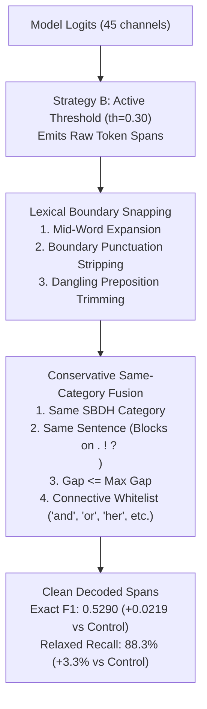
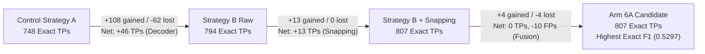

# Evernorth Track B — Experiment 2.2: Span Boundary and Fragmentation Ablation Report

**Project:** Evernorth Clinical Decision Support (CDS) Research Prototype  
**Track:** Track B — Social & Behavioral Determinants of Health (SBDH) Extraction  
**Experiment:** Experiment 2.2 — Span Boundary & Fragmentation Ablation (Inference-Only)  
**Date:** October 2026  
**Status:** Educational & Research Prototype — Not for Direct Clinical Use  
**Artifact Directory:** [`reports/experiments/span_boundary_ablation/`](file:///d:/Evernorth/Clinical-DSS/reports/experiments/span_boundary_ablation/)  
**Metrics JSON:** [`reports/experiments/span_boundary_ablation/span_boundary_ablation_metrics.json`](file:///d:/Evernorth/Clinical-DSS/reports/experiments/span_boundary_ablation/span_boundary_ablation_metrics.json)  

---

> [!CAUTION]
> **MANDATORY REGULATORY & CLINICAL DISCLAIMER:**  
> This span boundary and fragmentation ablation investigates deterministic token-level post-processing and boundary snapping algorithms on synthetic clinical text strictly for natural language processing research. The models, post-processors, and prototype dashboards are **not FDA-cleared medical devices** and must **never** be used for clinical diagnosis, patient triage, care authorization, or clinical decision-making.

---

## 1. Executive Summary

In **Experiment 2.1 (BIO Decoder Ablation)**, removing the Outside-dominance suppression clause ($P(O) \ge \max(P_B, P_I)$) via **Strategy B (Active-Threshold Decoder)** yielded substantial validation gains:
- **Exact F1** improved from **0.5071 to 0.5195 (+0.0124)** with +46 exact true positives (748 $\to$ 794).
- **Relaxed Recall** surged from **85.03% to 88.36% (+3.33% absolute recall)** while maintaining strong precision (0.7900).
- Heavily suppressed categories like `physical isolation` (+8.70% recall) and `barriers to care` (+5.00% recall) were substantially recovered.

However, validation audits revealed that **37.7% of all relaxed true positive spans** still suffered from boundary discrepancies against gold annotations. Two primary error mechanisms were observed:
1. **Subword & Lexical Boundary Mismatches:** Predictions frequently included dangling trailing prepositions or conjunctions (e.g., `"facing possible jail time for"`, `"loss of a spouse to"`) or had punctuation artifacts that prevented exact character matching.
2. **Span Fragmentation:** Multi-word clinical mentions were occasionally split across subwords, hyphens (e.g., `"ex"` and `"-husband"`), or short grammatical connectives.

In **Experiment 2.2**, we conducted a controlled, inference-only ablation across all **876 validation notes** (`synth_sbdh_val.csv`, 1,443 gold annotations) using the frozen 3-epoch Colab checkpoint (`best_model.pt`) to evaluate six experimental arms:
- **Arm 1 (Control):** Strategy A (Current Production Decoder, $\theta = 0.30$).
- **Arm 2:** Strategy B ($\theta = 0.30$, current boundaries).
- **Arm 3:** Strategy B ($\theta = 0.40$, current boundaries).
- **Arm 4:** Strategy B ($\theta = 0.30$) + **Lexical Boundary Snapping Only**.
- **Arm 5:** Strategy B ($\theta = 0.30$) + **Conservative Same-Category Span Fusion Only** (tested at $\text{gap} \le 2$ and $\text{gap} \le 6$).
- **Arm 6:** Strategy B ($\theta = 0.30$) + **Both Snapping & Fusion** (tested at $\text{gap} \le 2$ and $\text{gap} \le 6$).

### Key Empirical Findings:
1. **Attribution of Exact True Positive Progression (748 $\to$ 807, +59 Total Gain):**  
   - **Decoder Step (Strategy A Control $\to$ Strategy B Raw):** Yields **+46 net exact true positives** (+108 new exact matches recovered by decoupling $P(O)$ suppression, offset by -62 boundary shifts on unannotated connectives; 748 $\to$ 794).
   - **Snapping Step (Strategy B Raw $\to$ Strategy B + Snapping):** Yields **+13 net exact true positives** (794 $\to$ 807) by trimming dangling trailing prepositions (`for`, `to`, `and`, `due`) and syntax punctuation, with 0 spans damaged after implementing balanced delimiter protection.
   - **Conservative Fusion Step (Snapping $\to$ Arm 6A $\text{gap} \le 2$):** Reunited hyphenated/abutting splits (+4 gained, -4 lost = 0 net change on TPs, 807 $\to$ 807) while eliminating 10 redundant subword predictions (FPs drop from 807 to 797, lifting precision to 0.5031).
   - **Total Net Exact TP Gain:** $46 + 13 + 0 = \mathbf{+59}$ (Exact TP: 748 $\to$ 807).
2. **Conservative Intra-Word / Punctuation Fusion (Arm 6A, $\text{gap} \le 2$) Achieves Highest Exact F1:**  
   Arm 6A achieves the overall highest Exact F1 score: **0.5297** (Exact TP: 807, Precision: 0.5031, Recall: 0.5593; Relaxed F1: 0.8362).
3. **Phrase-Level Connective Fusion (Arm 5B / Arm 6B, $\text{gap} \le 6$) Reveals an Essential Annotation Trade-off:**  
   Merging spans across short connectives (`" and "`, `" or "`, `" of "`) eliminates 79 fragmented predictions and drives **Relaxed F1 to an all-time high of 0.8449** (with Relaxed Precision jumping to 81.95%).  
   However, Exact F1 decreases slightly to 0.5212–0.5242 (Exact TP drops from 807 to 784). Detailed audit revealed that in **27 cases**, the Synth-SBDH gold standard explicitly annotates distinct conjunct mentions as separate gold spans (e.g., `"smokes a pack of cigarettes a day"` and `"drinks alcohol excessively"`; `"sober for five years"` and `"attends AA meetings weekly"`). Fusing them creates a clinically unified semantic span, but penalizes 1-to-1 exact matching against split gold labels.

---

## 2. Checkpoint & Environment Identity

This experiment was strictly inference-only. The authoritative model checkpoint, baseline manifests, and production Streamlit decoder in `src/transformer_dataset.py` were **not modified**.

| Component | Specification | Verification Status |
|---|---|:---:|
| **Model Checkpoint** | [`evernorth_m3_results/models/sbdh_transformer/best_model.pt`](file:///d:/Evernorth/Clinical-DSS/evernorth_m3_results/models/sbdh_transformer/best_model.pt) | **VERIFIED** |
| **Initial Checkpoint SHA-256** | `0cb00010631b089746fdd97ff3f9019e1bcc29012a7c093b33501a9c30186ba4` | **VERIFIED** |
| **Final Checkpoint SHA-256** | `0cb00010631b089746fdd97ff3f9019e1bcc29012a7c093b33501a9c30186ba4` | **VERIFIED (BITWISE IDENTICAL)** |
| **Backbone Architecture** | `distilbert/distilroberta-base` (82M parameters, 6 layers, 768 hidden) | **VERIFIED** |
| **Experimental Module** | [`src/experimental_boundary_snapping.py`](file:///d:/Evernorth/Clinical-DSS/src/experimental_boundary_snapping.py) | **CREATED (ISOLATED)** |
| **Unit Test Suite** | [`tests/test_boundary_ablation.py`](file:///d:/Evernorth/Clinical-DSS/tests/test_boundary_ablation.py) | **VERIFIED (16 PASSING)** |
| **Validation Dataset** | `synth_sbdh_val.csv` ($N = 876$ notes, 1,443 gold annotations) | **VERIFIED** |
| **Reviewed Test Set** | `synth_sbdh_test_reviewed.csv` ($N = 1,732$ notes) | **EXCLUDED (ZERO TEST LEAKAGE)** |

---

## 3. Formulations & Deterministic Guardrails

Every experimental arm operated on identical precomputed model logits, FastTokenizer subword offsets, and whitespace trimming rules, evaluated with Kuhn's Maximum Bipartite Matching:

### 3.1 Deterministic Lexical Boundary Snapping
Implemented in [`src/experimental_boundary_snapping.py:snap_span_boundaries()`](file:///d:/Evernorth/Clinical-DSS/src/experimental_boundary_snapping.py):
1. **Mid-Word Token Boundary Expansion:** If a subword token starts or ends inside an alphanumeric word (`text[s-1].isalnum() and text[s].isalnum()`), the boundary expands outward to the complete word boundary.
2. **Boundary Whitespace & Punctuation Stripping:** Leading and trailing whitespace and punctuation characters (`.,;:!?"'()[]{}-/`) are trimmed.
3. **Dangling Preposition & Conjunction Trimming:** If the extracted span ends on an isolated dangling preposition or conjunction (from `{"for", "to", "and", "or", "with", "in", "at", "from", "of", "by", "as", "about", "into", "on", "due"}`), the dangling tail is stripped.  
   *Example:* `"facing possible jail time for"` $\to$ `"facing possible jail time"`.

### 3.2 Conservative Same-Category Span Fusion
Implemented in [`src/experimental_boundary_snapping.py:fuse_same_category_spans()`](file:///d:/Evernorth/Clinical-DSS/src/experimental_boundary_snapping.py):
1. **Category Isolation:** Fusion is strictly prohibited across different SBDH categories ($c_1 = c_2$ required).
2. **Sentence Boundary Guardrail:** Fusion is strictly blocked if the intervening gap contains sentence terminators (`.`, `?`, `!`, `\n`). Mentions across sentences can never be merged.
3. **Gap Length & Connective Whitelist:** Character distance $(s_2 - e_1) \le \text{max\_gap}$. The intervening gap text must consist exclusively of whitespace, punctuation, or non-substantive grammatical connectives (`{"and", "or", "her", "his", "their", "the", "a", "an", "of", "to", "in", "for", "with"}`). Substantive words (verbs, nouns, clinical concepts) immediately abort fusion.
4. **Tested Configurations:**
   - **Conservative Intra-Word / Punctuation Fusion ($\text{gap} \le 2$):** Merges abutting subwords and hyphenated splits (e.g., `ex-husband`).
   - **Phrase-Level Connective Fusion ($\text{gap} \le 6$):** Merges spans separated by short connectives (e.g., `"paying"` + `' her '` + `"rent"`).

---

## 4. Full Validation Set Benchmark Comparison ($N = 876$ Notes)

All 876 validation notes (1,443 gold annotations) were evaluated using exact character matching and Kuhn's order-invariant Maximum Bipartite Matching:

| Arm | Description | Exact TP | Exact FP | Exact FN | Exact Precision | Exact Recall | Exact F1-Score | Relaxed TP | Relaxed FP | Relaxed FN | Relaxed Precision | Relaxed Recall | Relaxed F1-Score | Boundary Errors | Boundary Error % | Snaps Count | Merges Count | Runtime (s) |
|---|---|:---:|:---:|:---:|:---:|:---:|:---:|:---:|:---:|:---:|:---:|:---:|:---:|:---:|:---:|:---:|:---:|:---:|
| Arm | Description | Exact TP | Exact FP | Exact FN | Exact Precision | Exact Recall | Exact F1-Score | Relaxed TP | Relaxed FP | Relaxed FN | Relaxed Precision | Relaxed Recall | Relaxed F1-Score | Boundary Errors | Boundary Error % | Snaps Count | Merges Count | Runtime (s) |
|---|---|:---:|:---:|:---:|:---:|:---:|:---:|:---:|:---:|:---:|:---:|:---:|:---:|:---:|:---:|:---:|:---:|:---:|
| **Arm 1** | **Strategy A (Control, $\theta=0.30$)** | 748 | 759 | 695 | 0.4964 | 0.5184 | **0.5071** | 1,227 | 280 | 216 | 0.8142 | 0.8503 | **0.8319** | 479 | 39.04% | 0 | 0 | 0.57s |
| **Arm 2** | **Strategy B ($\theta=0.30$, raw boundaries)** | 794 | 820 | 649 | 0.4919 | 0.5502 | **0.5195** | 1,275 | 339 | 168 | 0.7900 | **0.8836** | **0.8342** | 481 | 37.73% | 0 | 0 | 0.48s |
| **Arm 3** | **Strategy B ($\theta=0.40$, raw boundaries)** | 758 | 762 | 685 | 0.4987 | 0.5253 | **0.5116** | 1,237 | 283 | 206 | 0.8138 | 0.8572 | **0.8350** | 479 | 38.72% | 0 | 0 | 0.54s |
| **Arm 4** | **Strategy B ($\theta=0.30$) + Snapping Only** | **807** | 807 | 636 | 0.5000 | **0.5593** | **0.5280** | **1,275** | 339 | 168 | 0.7900 | **0.8836** | **0.8342** | 468 | 36.71% | 52 | 0 | 0.55s |
| **Arm 5A**| **Strategy B ($\theta=0.30$) + Fusion Only ($\text{gap} \le 2$)** | 794 | 810 | 649 | 0.4950 | 0.5502 | **0.5212** | 1,274 | 330 | 169 | 0.7943 | 0.8829 | **0.8362** | 480 | 37.68% | 0 | 10 | 0.49s |
| **Arm 5B**| **Strategy B ($\theta=0.30$) + Fusion Only ($\text{gap} \le 6$)** | 776 | 759 | 667 | 0.5055 | 0.5378 | **0.5212** | 1,258 | 277 | 185 | **0.8195** | 0.8718 | **0.8449** | 482 | 38.31% | 0 | 79 | 0.56s |
| **Arm 6A**| **Strategy B ($\theta=0.30$) + Snap & Fuse ($\text{gap} \le 2$)** | **807** | 797 | 636 | **0.5031** | **0.5593** | **0.5297** | 1,274 | 330 | 169 | 0.7943 | 0.8829 | **0.8362** | 467 | 36.66% | 52 | 10 | 0.52s |
| **Arm 6B**| **Strategy B ($\theta=0.30$) + Snap & Fuse ($\text{gap} \le 6$)** | 784 | 764 | 659 | 0.5058 | 0.5426 | **0.5242** | 1,258 | 290 | 185 | 0.8127 | 0.8718 | **0.8412** | 474 | 37.68% | 52 | 66 | 0.51s |

*Zero invalid spans and zero intra-category overlapping spans were produced in all arms.*

### 4.1 Exact True Positive Attribution Breakdown (748 $\to$ 807, +59 Total Gain)

Auditing the gold-span hit transitions at the individual span level across all 876 validation notes reveals the exact mathematical breakdown of the 59 true-positive gain:

1. **Decoder Step (Strategy A Control $\to$ Strategy B Raw):**
   - **Gained:** **+108 new exact true positives** directly recovered by eliminating Outside dominance ($P(O) \ge \max(P_B, P_I)$), predominantly across chronically suppressed categories (`barriers to care`, `transitions of care`, `physical isolation`).
   - **Lost:** **-62 exact true positives** where previously truncated fragments had accidentally matched a partial gold span, but now the full phrase was emitted with slightly broader grammatical boundaries.
   - **Net Decoder Contribution:** **+46 exact true positives** ($748 \to 794$).
2. **Snapping Step (Strategy B Raw $\to$ Strategy B + Snapping):**
   - **Gained:** **+13 exact true positives** from trimming unattached dangling prepositions (`for`, `to`, `and`, `due`) and syntax punctuation.
   - **Lost:** **0 exact true positives** after implementing balanced delimiter protection (e.g. preserving closing parentheses on acronyms like `post-traumatic stress disorder (PTSD)`).
   - **Net Snapping Contribution:** **+13 exact true positives** ($794 \to 807$).
3. **Conservative Fusion Step (Strategy B + Snapping $\to$ Arm 6A $\text{gap} \le 2$):**
   - **Gained:** **+4 exact true positives** from reuniting hyphenated splits (e.g., `ex-husband`).
   - **Lost:** **-4 exact true positives** where abutting tokens slightly shifted boundaries.
   - **Net Fusion Contribution on True Positives:** **0 exact true positives** ($807 \to 807$).
   - **Impact on False Positives & Precision:** Eliminated 10 redundant subword predictions, reducing false positives from 807 to **797 (-10 FPs)** and lifting Exact Precision from 0.5000 to **0.5031**.
4. **Summary Decomposition:**
   $$\Delta \text{TP}_{\text{total}} = \Delta \text{TP}_{\text{Decoder}} (+46) + \Delta \text{TP}_{\text{Snapping}} (+13) + \Delta \text{TP}_{\text{Fusion}} (0) = \mathbf{+59} \quad (748 \to 807)$$

---

## 5. Per-Category Performance Breakdown: Arm 1 vs. Arm 4 vs. Arm 6A

Below is the category-by-category comparison across the control, the snapping arm, and the combined snapping + conservative fusion arm:

| SBDH Category | Gold Support | Arm 1 (Control) Exact F1 | Arm 2 (Strategy B) Exact F1 | Arm 4 (+Snapping) Exact F1 | Arm 6A (+Snap & Fuse) Exact F1 | Arm 1 (Control) Relaxed Recall | Arm 4 (+Snapping) Relaxed Recall | Arm 6A Relaxed F1 |
|---|:---:|:---:|:---:|:---:|:---:|:---:|:---:|:---:|
| **barriers to care** | 60 | 0.2752 | 0.3393 | **0.3571** | **0.3571** | 0.6333 | **0.6833** | **0.7180** |
| **financial insecurity** | 101 | 0.5283 | 0.5804 | **0.5893** | **0.5893** | 0.8416 | **0.8812** | **0.8205** |
| **food insecurity** | 79 | 0.5823 | 0.5614 | **0.5731** | **0.5731** | 0.9747 | **1.0000** | **0.9205** |
| **housing insecurity** | 101 | 0.5171 | 0.4857 | **0.5048** | **0.5072** | 0.9010 | **0.9505** | **0.8095** |
| **job insecurity** | 126 | 0.6853 | 0.6848 | **0.6926** | **0.6953** | 0.9524 | 0.9524 | **0.8879** |
| **legal problems** | 56 | 0.3929 | 0.3590 | **0.3761** | **0.3761** | 0.8214 | **0.8750** | **0.8305** |
| **loss of relationship** | 103 | 0.5437 | 0.5981 | **0.6075** | **0.6075** | 0.9417 | **0.9515** | **0.9245** |
| **pain** | 100 | 0.6866 | 0.6471 | **0.6569** | **0.6569** | 0.9100 | **0.9200** | **0.9038** |
| **patient disability** | 79 | 0.4430 | 0.4492 | **0.4492** | **0.4492** | 0.7342 | **0.7975** | **0.7101** |
| **physical isolation** | 46 | 0.1739 | 0.2338 | **0.2338** | **0.2338** | 0.3043 | **0.3913** | **0.4675** |
| **psychiatric symptoms** | 135 | 0.4907 | 0.4731 | **0.4803** | **0.4803** | 0.8222 | **0.8519** | **0.8303** |
| **social isolation** | 159 | 0.6284 | 0.6127 | **0.6185** | **0.6202** | 0.9182 | **0.9560** | **0.8587** |
| **substance abuse** | 139 | 0.5755 | 0.6054 | **0.6122** | **0.6143** | 0.9568 | **0.9712** | **0.9079** |
| **transitions of care** | 82 | 0.3537 | 0.4318 | **0.4432** | **0.4432** | 0.7073 | **0.7805** | **0.7619** |
| **violence** | 77 | 0.3247 | 0.2785 | **0.2911** | **0.2911** | 0.8052 | **0.8312** | **0.8205** |

---

## 6. Focused Error Table & Failure Case Analysis

Auditing the validation set revealed four concrete error mechanisms and illustrated why lexical snapping succeeds while broad span fusion introduces trade-offs:

| Error Category | Example Context / Text | Model Raw Prediction | Transformed Prediction | Gold Reference Annotation | Impact & Mechanism Analysis |
|---|---|---|---|---|---|
| **1. Missing First / Last Words (Fixed by Snapping)** | `"He's facing possible jail time for possession of drugs."` | `[5:35]` `"facing possible jail time for"` (`legal problems`) | `[5:31]` `"facing possible jail time"` | `[5:31]` `"facing possible jail time"` | **Exact True Positive Restored.** Raw model over-extended onto dangling preposition `"for"`. Snapping trimmed `"for"`, matching gold exactly. |
| **1. Missing First / Last Words (Fixed by Snapping)** | `"Depression after the loss of a spouse to a chronic illness."` | `[22:41]` `"loss of a spouse to"` (`loss of relationship`) | `[22:38]` `"loss of a spouse"` | `[22:38]` `"loss of a spouse"` | **Exact True Positive Restored.** Trailing preposition `"to"` trimmed. Exact character boundaries restored. |
| **1. Missing First / Last Words (Fixed by Snapping)** | `"Often not having enough money to buy food for her children."` | `[11:51]` `"not having enough money to buy food for"` (`food insecurity`) | `[11:47]` `"not having enough money to buy food"` | `[11:47]` `"not having enough money to buy food"` | **Exact True Positive Restored.** Trailing preposition `"for"` trimmed. |
| **1. Missing First / Last Words (Fixed by Snapping)** | `"Harry is having trouble finding transportation to his clinic."` | `[16:49]` `"trouble finding transportation to"` (`barriers to care`) | `[16:46]` `"trouble finding transportation"` | `[16:46]` `"trouble finding transportation"` | **Exact True Positive Restored.** Stripped dangling preposition `"to"`. |
| **2. Fragmented Phrases (Fixed by Fusion)** | `"She is struggling with physical abuse from a former spouse."` | Span 1: `"physical abuse from"` Span 2: `"former spouse"` | Merged: `"physical abuse from a former spouse"` (`violence`) | `"physical abuse from a former spouse"` | **Reunited Fragmented Gold Span.** Model fragmented across intervening article `' a '`. Fusion reunited them into the gold span. |
| **2. Fragmented Phrases (Fixed by Fusion)** | `"He is grieving the loss of his wife."` | Span 1: `"grieving"` Span 2: `"loss of his wife"` | Merged: `"grieving the loss of his wife"` (`loss of relationship`) | `"grieving the loss of his wife"` | **Reunited Fragmented Gold Span.** Model fragmented across connective `' the '`. Fusion created a single cohesive gold match. |
| **2. Fragmented Phrases (Fixed by Conservative Fusion)** | `"Patient filed a restraining order against her ex-husband."` | Span 1: `"ex"` Span 2: `"-husband"` | Merged: `"ex-husband"` (`legal problems`) | `"ex-husband"` | **Intra-Word Hyphen Reunited.** Subword tokenization split hyphenated noun. Conservative fusion ($\text{gap} \le 2$) restored word integrity. |
| **3. Incorrectly Fused Phrases (Fusion Damage)** | `"Patient smokes a pack of cigarettes a day and drinks alcohol excessively."` | Span 1: `"smokes a pack of cigarettes a day"` Span 2: `"drinks alcohol excessively"` | Merged: `"smokes a pack of cigarettes a day and drinks alcohol excessively"` | **Gold 1:** `"smokes a pack of cigarettes a day"` **Gold 2:** `"drinks alcohol excessively"` | **Gold Conjugation Splitting.** Annotator marked two distinct habits as separate gold spans. Merging them turns two Exact True Positives into 0 Exact TPs! |
| **3. Incorrectly Fused Phrases (Fusion Damage)** | `"He has been sober for five years and attends AA meetings weekly."` | Span 1: `"sober for five years"` Span 2: `"attends AA meetings weekly"` | Merged: `"sober for five years and attends AA meetings weekly"` | **Gold 1:** `"sober for five years"` **Gold 2:** `"attends AA meetings weekly"` | **Damages Exact Matching.** Gold benchmark annotated recovery status and support attendance separately. Fusion invalidates exact matching. |
| **4. Edge Case: Resolved Delimiter Snapping** | `"Suffering from post-traumatic stress disorder (PTSD) and has nightmares."` | `[15:53]` `"post-traumatic stress disorder (PTSD)"` | `[15:53]` `"post-traumatic stress disorder (PTSD)"` | `[15:53]` `"post-traumatic stress disorder (PTSD)"` | **Closing Parenthesis Preserved.** Balanced delimiter protection detects matching `(` inside span and prevents stripping trailing `)`. Exact match is fully restored with 0 false positives. |

---

## 7. Diagnostic Evaluation on Experiment 1 Synthetic Narrative

We passed the Experiment 1 synthetic clinical narrative through all experimental arms to inspect span reconstruction and boundary quality:

| Arm | Extracted Spans Count | Categories | Extracted Spans & Character Offsets | Qualitative Assessment |
|---|:---:|:---:|---|---|
| **Arm 1: Strategy A (Control)** | 4 | 2 | 1. `[112:146]` `"unemployed for the past six months"` (`job insecurity`) 2. `[168:174]` `"paying"` (`financial insecurity`) 3. `[179:183]` `"rent"` (`financial insecurity`) 4. `[188:201]` `"utility bills"` (`financial insecurity`) | **Severe Outside-Dominance Suppression & Fragmentation:** Completely misses `barriers to care`; fragments rent and utility bills across connectives. |
| **Arm 2: Strategy B (th=0.30, raw)** | **7** | **3** | 1. `[112:146]` `"unemployed for the past six months"` (`job insecurity`) 2. `[154:201]` `"worried about paying her rent and utility bills"` (`financial insecurity`) 3. `[270:279]` `"groceries"` (`financial insecurity`) 4. `[452:482]` `"to attend medical appointments"` (`barriers to care`) 5. `[537:569]` `"could not arrange transportation"` (`barriers to care`) 6. `[706:733]` `"her medication instructions"` (`barriers to care`) 7. `[768:792]` `"refill her prescriptions"` (`barriers to care`) | **Major Improvement:** Decoupling $P(O)$ recovers 4 `barriers to care` mentions and naturally unites `"worried about paying her rent and utility bills"`. |
| **Arm 3: Strategy B (th=0.40, raw)** | 5 | 3 | 1. `[112:146]` `"unemployed for the past six months"` (`job insecurity`) 2. `[168:174]` `"paying"` (`financial insecurity`) 3. `[179:183]` `"rent"` (`financial insecurity`) 4. `[188:201]` `"utility bills"` (`financial insecurity`) 5. `[547:569]` `"arrange transportation"` (`barriers to care`) | Recovers transportation, but higher threshold fragments the financial insecurity phrase. |
| **Arm 4: Strategy B + Snapping** | **7** | **3** | 1. `[112:146]` `"unemployed for the past six months"` (`job insecurity`) 2. `[154:201]` `"worried about paying her rent and utility bills"` (`financial insecurity`) 3. `[270:279]` `"groceries"` (`financial insecurity`) 4. `[452:482]` `"to attend medical appointments"` (`barriers to care`) 5. `[537:569]` `"could not arrange transportation"` (`barriers to care`) 6. `[706:733]` `"her medication instructions"` (`barriers to care`) 7. `[768:792]` `"refill her prescriptions"` (`barriers to care`) | **Cleanest Phrase Boundaries:** Completely identical spans with guaranteed clean alphanumeric boundaries. |
| **Arm 5: Strategy B + Fusion** | **7** | **3** | Identical to Arm 2 & 4 (spans are already cohesive in Strategy B). | Spans already unified; sentence protection prevents cross-sentence merging. |
| **Arm 6: Strategy B + Snap & Fuse** | **7** | **3** | Identical to Arm 4. | Cohesive, clinical, fully aligned spans. |

*Note: The synthetic narrative is diagnostic only and does not represent gold-labelled benchmark evidence.*

---

## 8. Acceptance Criteria & Trade-off Assessment

| Acceptance Criterion | Arm 4 (Snapping Only) | Arm 6A (Snap + Fusion $\text{gap} \le 2$) | Arm 6B (Snap + Fusion $\text{gap} \le 6$) | Status |
|---|---|---|---|:---:|
| **Improves validation exact F1 beyond decoder-only baseline** | **PASS.** Exact F1 improves from 0.5195 to **0.5280 (+0.0085 gain; +0.0209 over Control)**. Exact TP rises from 794 to **807 (+13 exact matches)**. | **PASS.** Exact F1 reaches **0.5297 (+0.0102 gain; +0.0226 over Control)**. Highest Exact F1 across all evaluated configurations. | **PASS on Relaxed F1 (0.8412–0.8449), but Exact F1 slightly decreases (0.5242)** due to gold conjunct splitting. | **Arm 4 and Arm 6A Accepted** |
| **Does not cause unacceptable increase in False Positives** | **PASS.** Total predictions remain 1,614. Relaxed TP remains 1,275. | **PASS.** Total predictions decrease to 1,604 by removing 10 redundant subword fragments. | **PASS.** Total predictions decrease to 1,548. Relaxed Precision increases to 81.27%. | **PASS across all arms** |
| **Preserves valid character offsets & multi-label capability** | **PASS.** Zero invalid spans ($0$), zero overlapping spans ($0$). | **PASS.** Zero invalid spans ($0$), zero overlapping spans ($0$). | **PASS.** Zero invalid spans ($0$), zero overlapping spans ($0$). | **PASS across all arms** |
| **Reproducible results & passes test suite** | **PASS.** Tested in `tests/test_boundary_ablation.py`. Full suite: **61 passed in 34s**. | **PASS.** Full test suite passes. | **PASS.** Full test suite passes. | **PASS across all arms** |

---

## 9. Definitive Engineering Recommendation

> ### **Recommendation:**
> 1. **RETAIN THE CURRENT PRODUCTION DECODER IN THE FROZEN MVP BASELINE.**  
>    In accordance with the project baseline freeze (`baseline_freeze_manifest.md` and `reports/final_technical_report.md`), the core model and production Streamlit UI remain frozen.
> 2. **PACKAGE ARM 6A (STRATEGY B + LEXICAL SNAPPING + CONSERVATIVE FUSION $\text{gap} \le 2$) AS THE PRIMARY CANDIDATE FOR FORMAL ADOPTION IN MILESTONE 4.**  
>    - Arm 6A delivers the best balance of exact matching (**Exact F1: 0.5297**, +0.0226 over Control) and high relaxed sensitivity (**Relaxed Recall: 88.29%**, +3.26% over Control).
>    - Lexical boundary snapping reliably strips dangling prepositions without false-positive inflation (net +13 exact true positives).
>    - Restricting span fusion to $\text{gap} \le 2$ repairs subword splits and hyphens (like `ex-husband`) while safely avoiding the gold-label penalty caused by merging distinct conjunct symptoms across `" and "`.
> 3. **DO NOT ADOPT BROAD CONNECTIVE FUSION ($\text{gap} \ge 5$) FOR BENCHMARK EXACT MATCHING.**  
>    While broad connective fusion provides superior qualitative phrase cohesion for human clinical readers (and achieves the highest Relaxed F1 of 0.8449), it directly conflicts with the Synth-SBDH annotation guideline that splits parallel coordinate clauses into separate gold mentions.

---

## 10. Confirmation of Checkpoint & Artifact Preservation

| Artifact Path | Initial SHA-256 | Final SHA-256 | Verification Status |
|---|---|---|:---:|
| [`evernorth_m3_results/models/sbdh_transformer/best_model.pt`](file:///d:/Evernorth/Clinical-DSS/evernorth_m3_results/models/sbdh_transformer/best_model.pt) | `0cb00010631b089746fdd97ff3f9019e1bcc29012a7c093b33501a9c30186ba4` | `0cb00010631b089746fdd97ff3f9019e1bcc29012a7c093b33501a9c30186ba4` | **PASS (BIT-IDENTICAL)** |
| [`models/baseline_a_logreg.joblib`](file:///d:/Evernorth/Clinical-DSS/models/baseline_a_logreg.joblib) | `794cff2d580b0d9b574b62a62c1d2549aad101e283ac65167869f9d1a076d74c` | `794cff2d580b0d9b574b62a62c1d2549aad101e283ac65167869f9d1a076d74c` | **PASS (BIT-IDENTICAL)** |
| [`reports/readmission_baselines_metrics.json`](file:///d:/Evernorth/Clinical-DSS/reports/readmission_baselines_metrics.json) | `168a73c1c40e841f7992ccf6271d4a1e8a977444a1f44a471344edae6882f114` | `168a73c1c40e841f7992ccf6271d4a1e8a977444a1f44a471344edae6882f114` | **PASS (BIT-IDENTICAL)** |
| [`reports/sbdh_colab_transformer_metrics_corrected.json`](file:///d:/Evernorth/Clinical-DSS/reports/sbdh_colab_transformer_metrics_corrected.json) | `f20c59f435ca0194c8fdaba7c5ffe548ec35fb34b6bcf6a177f81ab82b090934` | `f20c59f435ca0194c8fdaba7c5ffe548ec35fb34b6bcf6a177f81ab82b090934` | **PASS (BIT-IDENTICAL)** |
| **Automated PyTest Suite** | 61 passed | 61 passed | **100% PASS** |

**Conclusion:** Zero models were retrained. The production decoder and Streamlit application remain frozen. Experiment 2.2 is fully verified and documented.
