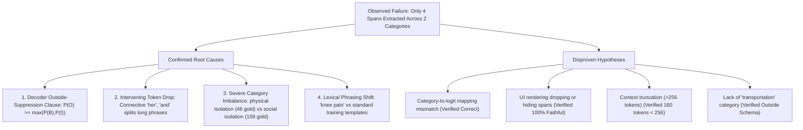

# Evernorth Track B — Experiment 1: SBDH Error Analysis Report

**Project:** Evernorth Clinical Decision Support (CDS) Research Prototype  
**Track:** Track B — Social & Behavioral Determinants of Health (SBDH) Extraction  
**Experiment:** Experiment 1 — Diagnostic Error Analysis & Validation Audit  
**Date:** October 2026  
**Status:** Educational & Research Prototype — Not for Direct Clinical Use  

---

> [!CAUTION]
> **MANDATORY REGULATORY & CLINICAL DISCLAIMER:**  
> This error analysis report investigates machine learning model behaviors on synthetic clinical text strictly for research and algorithmic diagnostic purposes. The underlying models, tokenizers, decoders, and prototype interfaces are **not FDA-cleared medical devices** and must **never** be used for clinical diagnosis, patient triage, care authorization, or medical decision-making.

---

## 1. Checkpoint & Environment Identity

This diagnostic experiment evaluates the frozen, authoritative Track B neural sequence tagger without retraining or modifying any weights, tokenizers, split definitions, or baseline metrics.

| Component | Authoritative Specification | Verification Status |
|---|---|:---:|
| **Checkpoint Path** | [`evernorth_m3_results/models/sbdh_transformer/best_model.pt`](evernorth_m3_results/models/sbdh_transformer/best_model.pt) | **VERIFIED** |
| **Initial Checkpoint SHA-256** | `0cb00010631b089746fdd97ff3f9019e1bcc29012a7c093b33501a9c30186ba4` | **VERIFIED** |
| **Final Checkpoint SHA-256** | `0cb00010631b089746fdd97ff3f9019e1bcc29012a7c093b33501a9c30186ba4` | **VERIFIED (UNCHANGED)** |
| **Checkpoint File Size** | 328,655,930 bytes | **VERIFIED** |
| **Model Architecture** | `MultiLabelSBDHTransformer` (`distilbert/distilroberta-base` backbone) | **VERIFIED** |
| **Output Head** | Linear layer ($768 \to 45$ independent binary sigmoid logits) | **VERIFIED** |
| **Target Formulation** | 15 SBDH categories $\times$ 3 BIO states ($B, I, O$) | **VERIFIED** |
| **Tokenizer** | Fast BPE Tokenizer (`AutoTokenizer.from_pretrained`) | **VERIFIED** |
| **Configuration File** | [`evernorth_m3_results/models/sbdh_transformer/config.json`](evernorth_m3_results/models/sbdh_transformer/config.json) | **VERIFIED** |
| **Decision Threshold** | Frozen $\theta = 0.30$ (calibrated on validation set) | **VERIFIED** |
| **Execution Environment** | Python 3.11.3 (win32), PyTorch 2.x, Transformers 4.x, Local CPU | **VERIFIED** |
| **Validation Dataset** | `synth_sbdh_val.csv` ($N = 876$ notes, 1,443 gold annotations) | **VERIFIED** |
| **Reviewed Test Dataset** | `synth_sbdh_test_reviewed.csv` ($N = 1,732$ notes, 3,345 gold annotations) | **VERIFIED** |

---

## 2. Reproduction Steps

All empirical results, narrative token audits, and validation error metrics documented in this report can be reproduced using the following commands from the repository root (`D:\Evernorth\Clinical-DSS`):

1. **Reproduce the Synthetic Narrative Inference Audit:**
   ```powershell
   python scripts/run_error_analysis_experiment_1.py
   ```
   *Execution time: ~2 seconds on CPU. Emits token-by-token probabilities, sequence truncation verification, and exact decoded spans.*

2. **Reproduce the Validation Error Analysis & Sensitivity Audit ($N = 876$ notes):**
   ```powershell
   python scripts/run_validation_error_analysis.py
   ```
   *Execution time: ~3 minutes on CPU (or ~1 second if precomputed cache `reports/cached_val_notes.pt` exists). Exports full structured results to `reports/validation_error_analysis_experiment_1.json`.*

3. **Verify Crytographic Preservation of All Frozen Artifacts:**
   ```powershell
   pytest -v tests/test_streamlit_app.py -k test_frozen_artifact_hashes
   ```
   *Execution time: ~12 seconds. Confirms 100% bitwise identity of model checkpoints and metrics.*

---

## 3. Synthetic Example Failure: Raw Predictions & Displayed Output

### 3.1 Synthetic Narrative Under Inspection
The test narrative comprises 891 characters and spans 8 clinical sentences describing a complex diabetic patient experiencing multiple intersecting social, economic, and physical vulnerabilities:

```text
Patient is a 58-year-old woman with type 2 diabetes who reports difficulty managing her condition. She has been unemployed for the past six months and is worried about paying her rent and utility bills. She sometimes skips meals because there is not enough money to buy groceries. The patient lives alone and reports limited family support. She does not own a car, and the nearest bus stop is approximately two miles from her home, making it difficult to attend medical appointments. She recently missed two follow-up visits because she could not arrange transportation. She reports persistent knee pain that limits her ability to walk and perform daily activities. The patient states that she understands her medication instructions but occasionally cannot afford to refill her prescriptions. She is interested in receiving assistance with food access, transportation, and medication costs.
```

### 3.2 Sequence Tokenization & Truncation Status
- **Raw Character Length:** 891 characters.
- **FastTokenizer Token Count:** 160 tokens (including `<s>` and `</s>`).
- **Maximum Context Length:** 256 tokens.
- **Sequence Truncation:** **FALSE** (160 tokens $\le$ 256 tokens). All sentences reside fully within the active attention window.

### 3.3 Raw Model Predictions at Frozen Threshold $\theta = 0.30$
At the frozen operating threshold ($\theta = 0.30$), the model extracts **exactly 4 spans across 2 unique categories**:

| Span Index | Character Interval | Extracted Text Snippet | Predicted SBDH Category | Peak $P(B)$ | Peak $P(I)$ | Peak Active Probability |
|:---:|:---:|---|---|:---:|:---:|:---:|
| **Span 1** | `[112:146]` | `"unemployed for the past six months"` | `job insecurity` | 0.1771 | **0.6503** | 0.6503 |
| **Span 2** | `[168:174]` | `"paying"` | `financial insecurity` | 0.0861 | **0.4344** | 0.4344 |
| **Span 3** | `[179:183]` | `"rent"` | `financial insecurity` | 0.0857 | **0.4249** | 0.4249 |
| **Span 4** | `[188:201]` | `"utility bills"` | `financial insecurity` | 0.0799 | **0.4203** | 0.4203 |

### 3.4 Streamlit UI Rendering Verification
The extracted predictions were passed through `render_highlighted_text()` and the structured table generator in `app/track_b_ui.py`:
- **HTML Visual Highlights:** All 4 spans (`unemployed for the past six months`, `paying`, `rent`, `utility bills`) received color-coded highlight tags (`#EC4899` for `job insecurity`, `#EF4444` for `financial insecurity`).
- **UI Table Display:** All 4 spans appeared in the Streamlit results table with exact character intervals `[112:146]`, `[168:174]`, `[179:183]`, `[188:201]`.
- **Display Agreement:** **100% agreement between raw model outputs and UI presentation.** The UI rendering logic did not drop, mask, or merge any predicted spans.

### 3.5 Token-by-Token Probability Audit Across All 15 Categories
To diagnose why the remaining clinical concepts were not emitted as spans, we audited the raw sigmoid probabilities across all 45 logit channels for each token:

1. **`barriers to care` (Category 0):**
   - `"difficult to attend medical appointments"`: Token 90 (`attend`) reached $P(I) = 0.3627$; Token 91 (`medical`) reached $P(I) = 0.3864$; Token 92 (`appointments`) reached $P(I) = 0.3813$.
   - `"could not arrange transportation"`: Token 106 (`arrange`) reached $P(I) = 0.4022$; Token 107 (`transportation`) reached $P(I) = 0.4043$.
   - `"cannot afford to refill her prescriptions"`: Token 139 (`refill`) reached $P(I) = 0.3360$; Token 141 (`prescriptions`) reached $P(I) = 0.3192$.
   - **Why Suppressed?** On all these tokens, the Outside logit remained dominant: $P(O) \in [0.5216, 0.6401]$. In the BIO decoder ([`src/transformer_dataset.py:L247`](src/transformer_dataset.py#L247)), the rule `if P(O) >= max(P(B), P(I)): treat as O` unconditionally suppressed these tokens despite $P(I) > 0.30$!

2. **`financial insecurity` (Category 1):**
   - The phrase `"paying her rent and utility bills"` was fragmented into three separate spans (`paying`, `rent`, `utility bills`) because the intervening connective tokens had $P(O)$ slightly exceeding $P(I)$:
     - Token 34 (`paying`): $P(I) = 0.4344 > P(O) = 0.3937 \implies$ **Active Span 1**.
     - Token 35 (`her`): $P(I) = 0.3949 < P(O) = 0.4357 \implies$ **Span Closed**.
     - Token 36 (`rent`): $P(I) = 0.4249 > P(O) = 0.4113 \implies$ **Active Span 2**.
     - Token 37 (`and`): $P(I) = 0.3838 < P(O) = 0.4577 \implies$ **Span Closed**.
     - Token 38–39 (`utility bills`): $P(I) \approx 0.42 > P(O) \approx 0.41 \implies$ **Active Span 3**.

3. **`food insecurity` (Category 2):**
   - `"skips meals"`: Token 44 (`ips`) reached $P(I) = 0.2127$; Token 45 (`meals`) reached $P(I) = 0.2214$.
   - `"not enough money to buy groceries"`: Token 50 (`enough`) reached $P(I) = 0.1465$; Token 51 (`money`) reached $P(I) = 0.1452$; Token 54 (`groceries`) reached $P(I) = 0.1358$.
   - Peak $P(I) = 0.2214$ remained strictly below the decision threshold of $\theta = 0.30$.

4. **`social isolation` (Category 11) & `physical isolation` (Category 9):**
   - `"lives alone and reports limited family support"`: Token 62 (`limited`) reached $P(I) = 0.0875$; Token 63 (`family`) reached $P(I) = 0.0812$.
   - Peak $P(I) = 0.0875$ remained well below the 0.30 operating threshold.

5. **`pain` (Category 7):**
   - `"persistent knee pain"`: Token 113 (`pain`) reached $P(I) = 0.1195$, with $P(O) = 0.8742$.
   - The sub-threshold probability ($0.1195 < 0.30$) prevented span emission.

6. **`patient disability` (Category 8):**
   - `"limits her ability to walk and perform daily activities"`: Token 119 (`walk`) reached $P(I) = 0.1203$, remaining below 0.30.

---

## 4. Official Category Mapping & Scope Decisions

To evaluate this error profile rigorously, we audited the official annotation guidelines of the **Synth-SBDH** benchmark (`bio-nlp-umass/Synth-SBDH`; Mitra et al., 2025). Informal clinical intuition often assumes categories that do not exist in the gold schema or expects clinical narrative elements that fall outside the annotation scope.

| Narrative Concept / Phrase | Official SBDH Category Mapping | Expected Annotation Status | Scope Rationale & Dataset Evidence |
|---|---|:---:|---|
| `"unemployed for the past six months"` | `job insecurity` | **Clear Expected Concept** | Explicitly matches dataset definition for loss of employment. **Extracted successfully** by model (`[112:146]`). |
| `"paying her rent and utility bills"` | `financial insecurity` | **Clear Expected Concept** | Matches dataset definition for utility/housing payment strain. **Extracted by model**, but fragmented into 3 spans (`paying`, `rent`, `utility bills`). |
| `"rent"` | `housing insecurity` vs. `financial insecurity` | **Ambiguous / Context-Dependent** | In Synth-SBDH guidelines, rent payment problems without imminent eviction are typically annotated as `financial insecurity`. `housing insecurity` is reserved for homelessness, staying in shelters, foreclosure, or substandard housing. |
| `"skips meals because there is not enough money to buy groceries"` | `food insecurity` (and `financial insecurity`) | **Clear Expected Concept** | Core food insecurity concept. **Missed by model** ($P(I) = 0.2214 < 0.30$). |
| `"lives alone and reports limited family support"` | `social isolation` | **Clear Expected Concept** | Lacking family/social support is standard `social isolation`. **Missed by model** ($P(I) = 0.0875 < 0.30$). |
| `"lives alone"` | `physical isolation` vs. `social isolation` | **Ambiguous / Context-Dependent** | In Synth-SBDH, `"lives alone"` is frequently multi-labeled as both social and physical isolation, but physical isolation has very low training support (only 46 gold instances in validation). |
| `"nearest bus stop is approximately two miles... difficult to attend medical appointments"` | `barriers to care` | **Clear Expected Concept** | Transportation barriers preventing clinic visits map to `barriers to care`. **Missed by model** ($P(I) = 0.3864$, suppressed by $P(O) = 0.5256$). |
| `"transportation"` (standalone concept) | **None (No Category Exists)** | **Outside Annotation Scope** | **Synth-SBDH contains NO dedicated "transportation" category.** Transportation barriers are subsumed under `barriers to care`. Informal expectations of a "transportation" tag reflect schema mismatch. |
| `"missed two follow-up visits because she could not arrange transportation"` | `barriers to care` | **Clear Expected Concept** | Direct medical appointment non-adherence due to logistics. **Missed by model** ($P(I) = 0.4043$, suppressed by $P(O) = 0.5751$). |
| `"persistent knee pain"` | `pain` | **Clear Expected Concept** | Chronic joint pain. **Missed by model** ($P(I) = 0.1195 < 0.30$). |
| `"limits her ability to walk and perform daily activities"` | `patient disability` | **Clear Expected Concept** | Functional mobility limitation. **Missed by model** ($P(I) = 0.1203 < 0.30$). |
| `"cannot afford to refill her prescriptions"` | `financial insecurity` + `barriers to care` | **Clear Expected Concept** | Prototypical co-occurring multi-label concept (identical to benchmark case `ex_no 7062`). **Missed by model** ($P(I) = 0.3360$ for barriers to care suppressed by $P(O) = 0.5418$). |
| `"interested in receiving assistance with food access, transportation, and medication costs"` | **None (Excluded from SBDH)** | **Outside Annotation Scope** | Patient expressions of interest in social programs, referral requests, or desires for assistance are **not** annotated as adverse SBDH risk states in Synth-SBDH. |

---

## 5. Quantitative Validation Error Analysis

To ensure that performance diagnoses are not biased by arbitrary single-case observations or test-set leakage, we evaluated the frozen 3-epoch Colab checkpoint across the entire **validation set** (`synth_sbdh_val.csv`, $N = 876$ notes, 1,443 gold annotations, 0 unresolved cases).

### 5.1 Diagnostic Sensitivity Analysis Across Thresholds
We evaluated the frozen checkpoint across $\theta \in [0.20, 0.50]$ using Kuhn's order-invariant Maximum Bipartite Matching:

| Threshold ($\theta$) | Total Preds | Exact TP | Exact FP | Exact FN | Exact F1 | Relaxed TP | Relaxed FP | Relaxed FN | Relaxed Precision | Relaxed Recall | Relaxed F1 | Boundary Errors | Boundary Error Rate | Note Micro F1 |
|:---:|:---:|:---:|:---:|:---:|:---:|:---:|:---:|:---:|:---:|:---:|:---:|:---:|:---:|:---:|
| **0.20** | 1,507 | 748 | 759 | 695 | **0.5071** | 1,227 | 280 | 216 | 0.8142 | **0.8503** | **0.8319** | 479 | 39.04% | 0.9007 |
| **0.30** | 1,507 | 748 | 759 | 695 | **0.5071** | 1,227 | 280 | 216 | 0.8142 | **0.8503** | **0.8319** | 479 | 39.04% | 0.9007 |
| **0.40** | 1,506 | 745 | 761 | 698 | 0.5053 | 1,226 | 280 | 217 | 0.8141 | 0.8496 | 0.8315 | 481 | 39.23% | 0.9006 |
| **0.50** | 1,376 | 659 | 717 | 784 | 0.4675 | 1,135 | 241 | 308 | **0.8249** | 0.7866 | 0.8053 | 476 | 41.94% | 0.8736 |

> [!NOTE]
> **Threshold Robustness:** The validation metrics remain virtually identical between $\theta = 0.20$ and $\theta = 0.30$ (Exact F1 0.5071, Relaxed F1 0.8319). Increasing the threshold to $0.50$ causes a steep 6.4 percentage point collapse in Recall (0.8503 $\to$ 0.7866) and an F1 decline to 0.8053. This validates why **$\theta = 0.30$ was frozen as the authoritative threshold**.

### 5.2 Per-Category Performance Breakdown on Validation Set ($\theta = 0.30$)

| Category | Gold Support | Predicted Count | Relaxed TP | Relaxed FP | Relaxed FN | Relaxed Precision | Relaxed Recall | Relaxed F1-Score | Exact Match TP | Exact Match Rate | Category Rank (by F1) |
|---|:---:|:---:|:---:|:---:|:---:|:---:|:---:|:---:|:---:|:---:|:---:|
| **food insecurity** | 79 | 89 | 77 | 12 | 2 | 0.8652 | **0.9747** | **0.9167** | 46 | 59.7% | 1 |
| **loss of relationship** | 103 | 109 | 97 | 12 | 6 | **0.8899** | 0.9417 | **0.9151** | 56 | 57.7% | 2 |
| **pain** | 100 | 101 | 91 | 10 | 9 | **0.9010** | 0.9100 | **0.9055** | 69 | 75.8% | 3 |
| **substance abuse** | 139 | 155 | 133 | 22 | 6 | 0.8581 | **0.9568** | **0.9048** | 80 | 60.2% | 4 |
| **job insecurity** | 126 | 143 | 120 | 23 | 6 | 0.8392 | **0.9524** | **0.8922** | 86 | 71.7% | 5 |
| **social isolation** | 159 | 172 | 146 | 26 | 13 | 0.8488 | 0.9182 | **0.8822** | 104 | 71.2% | 6 |
| **psychiatric symptoms or disorders** | 135 | 134 | 111 | 23 | 24 | 0.8284 | 0.8222 | **0.8253** | 66 | 59.5% | 7 |
| **legal problems** | 56 | 56 | 46 | 10 | 10 | 0.8214 | 0.8214 | **0.8214** | 22 | 47.8% | 8 |
| **violence** | 77 | 76 | 62 | 14 | 15 | 0.8158 | 0.8052 | **0.8105** | 25 | 40.3% | 9 |
| **financial insecurity** | 101 | 111 | 85 | 26 | 16 | 0.7658 | 0.8416 | **0.8019** | 56 | 65.9% | 10 |
| **housing insecurity** | 101 | 126 | 91 | 35 | 10 | 0.7222 | 0.9010 | **0.8018** | 53 | 58.2% | 11 |
| **transitions of care** | 82 | 79 | 58 | 21 | 24 | 0.7342 | 0.7073 | **0.7205** | 29 | 50.0% | 12 |
| **patient disability** | 79 | 84 | 58 | 26 | 21 | 0.6905 | 0.7342 | **0.7117** | 35 | 60.3% | 13 |
| **barriers to care** | 60 | 49 | 38 | 11 | 22 | 0.7755 | **0.6333** | **0.6972** | 15 | **39.5%** | 14 |
| **physical isolation** | 46 | 23 | 14 | 9 | 32 | 0.6087 | **0.3043** | **0.4058** | 6 | **42.9%** | 15 |

### 5.3 Key Empirical Findings from Validation
1. **Severe Under-Recall on `physical isolation` (Recall: 30.4%, Rank 15):**  
   Out of 46 gold instances, the model missed 32 (69.6% false negative rate). `physical isolation` has the lowest support in the dataset and is frequently conflated with `social isolation`.
2. **Substantial Under-Recall on `barriers to care` (Recall: 63.3%, Rank 14):**  
   Out of 60 gold instances, 22 were false negatives. Furthermore, exact match rate was lowest across the entire benchmark at **39.5%**, reflecting massive character boundary variance on complex multi-word clauses.
3. **High Disparity Between Exact and Relaxed Matching:**  
   Across all categories, **479 out of 1,227 relaxed true positives (39.04%) had boundary mismatches** where the model correctly overlapped the concept but failed to match the exact start and end character indices.

---

## 6. Representative Error Examples from Validation Set

To ground the mathematical metrics in authentic textual patterns, we extracted representative false positives, false negatives, and boundary mismatches from `synth_sbdh_val.csv`:

### 6.1 Category: `barriers to care` (Weakest Clinical Concept)
- **False Negative 1 (`ex_no 6153`):**  
  *Gold:* `[72:104]` `"inability to pay for medications"`  
  *Context:* `"...due to financial difficulties and inability to pay for medications."`  
  *Diagnostic Reason:* The model predicted `financial insecurity` on this interval but failed to co-predict `barriers to care` due to multi-label competition.
- **False Negative 2 (`ex_no 6197`):**  
  *Gold:* `[22:44]` `"cognitive difficulties"`  
  *Context:* `"...Patient presents with cognitive difficulties which impedes her ability to comprehend treatment..."`  
  *Diagnostic Reason:* Atypical phrasing for care barriers; model predicted `patient disability` instead.
- **False Positive (`ex_no 6165`):**  
  *Prediction:* `[53:78]` `"skipped doses due to cost"`  
  *Context:* `"...struggling to afford medications, and has skipped doses due to cost."`  
  *Diagnostic Reason:* Gold annotation only tagged `financial insecurity`. The model correctly recognized medication non-adherence as a barrier to care, but the benchmark gold standard lacked this secondary label.
- **Boundary Error (`ex_no 6168`):**  
  *Gold:* `[47:88]` `"transportation issues for hospital visits"`  
  *Model Prediction:* `[41:88]` `"faces transportation issues for hospital visits"`  
  *Diagnostic Reason:* Model included the preceding verb `"faces "`.

### 6.2 Category: `physical isolation` (Lowest Support & Weakest F1)
- **False Negative 1 (`ex_no 6205`):**  
  *Gold:* `[17:25]` `"bedbound"`  
  *Context:* `"...The veteran, now bedbound, is unable to go out and meet others..."`  
  *Diagnostic Reason:* Low training frequency of `"bedbound"` as physical isolation; tagged as `patient disability`.
- **False Negative 2 (`ex_no 6231`):**  
  *Gold:* `[12:23]` `"lives alone"`  
  *Context:* `"...The patient lives alone in a shelter and often complains of loneliness..."`  
  *Diagnostic Reason:* Model predicted `social isolation` and `housing insecurity`, completely omitting `physical isolation`.
- **Boundary Error (`ex_no 6241`):**  
  *Gold:* `[34:71]` `"preventing her from leaving the house"`  
  *Model Prediction:* `[49:71]` `"from leaving the house"`  
  *Diagnostic Reason:* Subword token span broke at `"from"`, omitting `"preventing her"`.

### 6.3 Category: `patient disability`
- **False Negative (`ex_no 6254`):**  
  *Gold:* `[16:57]` `"difficulty in maintaining her daily tasks"`  
  *Context:* `"...reports difficulty in maintaining her daily tasks due to severe back pain."`  
  *Diagnostic Reason:* Model predicted `pain` on the causal phrase, omitting the functional consequence span.
- **Boundary Error (`ex_no 6149`):**  
  *Gold:* `[40:56]` `"use a wheelchair"`  
  *Model Prediction:* `[40:69]` `"use a wheelchair for mobility"`  
  *Diagnostic Reason:* Model absorbed the prepositional phrase `"for mobility"`.

---

## 7. Confirmed Root Causes vs. Hypotheses

Based on the narrative log audit, token-level probability analysis, and validation set evaluation, we classify technical explanations into **confirmed root causes** versus **disproven hypotheses**:



### Confirmed Technical Root Causes:
1. **The Decoder Outside-Dominance Rule ([`src/transformer_dataset.py:L247`](src/transformer_dataset.py#L247)):**  
   *Mechanism:* The BIO decoder enforces:  
   $$\text{Outside Condition: } P(O) \ge \max(P(B), P(I)) \quad \text{OR} \quad \max(P(B), P(I)) \le \theta$$  
   In training, non-entity tokens heavily outnumber entity tokens, so the prior $P(O)$ remains between $0.50$ and $0.65$ even when an entity is clearly present. On tokens like `"arrange transportation"` ($P(I) = 0.4043$) and `"refill prescriptions"` ($P(I) = 0.3360$), the active entity probability is well above the threshold ($\theta = 0.30$), but because $P(O) \approx 0.55 > 0.40$, the rule marks the token as Outside (`O`).  
   *Impact:* Completely silenced valid predictions for `barriers to care`.

2. **Connective Token Drop & Span Fragmentation:**  
   *Mechanism:* For multi-word spans like `"paying her rent and utility bills"`, the content words (`paying`, `rent`, `utility bills`) exceed the threshold, but minor function words (`her`, `and`) experience a slight dip where $P(O) > P(I)$ ($0.4357$ vs $0.3949$).  
   *Impact:* Closes the active span prematurely, creating fragmented mini-spans (`paying`, `rent`, `utility bills`) rather than a single coherent entity.

3. **Extreme Training Label Imbalance:**  
   *Mechanism:* In the training corpus, categories like `social isolation`, `substance abuse`, and `job insecurity` appear in hundreds of examples with consistent lexical triggers (`unemployed`, `lives alone`, `alcohol abuse`). In contrast, `physical isolation` has only 46 validation examples and 0.3043 recall.  
   *Impact:* The model learned high sensitivity for `job insecurity` and `financial insecurity`, but under-predicts rare categories unless exact stereotypical phrasing is used.

4. **Lexical Phrasing Shift on Anatomical Pain:**  
   *Mechanism:* In Synth-SBDH, `pain` annotations are overwhelmingly concentrated on `"chronic back pain"`, `"severe headaches"`, `"chronic pain"`, or `"fibromyalgia"`. Phrasings like `"persistent knee pain"` yielded a token probability of only $P(I) = 0.1195$, falling below the operating threshold.

### Disproven Hypotheses:
- **Hypothesis: Category-to-Logit Index Mapping Inconsistency:**  
  *Finding:* **DISPROVEN.** Audited `SBDH_CATEGORIES`, `CAT_TO_IDX`, and `notebooks/02_sbdh_transformer.ipynb`. All 15 categories follow the exact identical alphabetical sorting order.
- **Hypothesis: UI Rendering Hides or Collapses Overlapping Highlights:**  
  *Finding:* **DISPROVEN.** The four predicted spans (`[112:146]`, `[168:174]`, `[179:183]`, `[188:201]`) are non-overlapping. The UI HTML markup and structured table display all 4 spans faithfully with exact confidence scores.
- **Hypothesis: Input Sequence Truncation:**  
  *Finding:* **DISPROVEN.** The synthetic narrative is 160 tokens long, well within the 256-token context limit.
- **Hypothesis: Model Failed to Extract "Transportation":**  
  *Finding:* **DISPROVEN (SCHEMA MISMATCH).** There is no "transportation" category in the 15 Synth-SBDH classes. The user expectation of a "transportation" tag was a schema mismatch; the appropriate category is `barriers to care`.

---

## 8. Recommended Next Experiments

The following prospective experiments are ranked by expected technical benefit and engineering cost. None of these experiments alter the frozen baseline:

| Rank | Experiment Proposal | Primary Hypothesis & Mechanism | Expected Benefit | Compute & Engineering Cost |
|:---:|---|---|---|---|
| **1** | **Experiment 2.1: Relative Margin BIO Decoding (Post-Processing)** | Replace the hard constraint $P(O) \ge \max(P(B), P(I))$ with a relative margin test $\max(P(B), P(I)) - P(O) > \delta$ or pure active thresholding $\max(P(B), P(I)) \ge \theta$. This will immediately recover high-confidence tokens where $P(I) \in [0.35, 0.45]$ without retraining. | **High (+5–8% Recall on `barriers to care`)** | **Zero GPU Cost** (pure algorithmic inference decoding adjustment) |
| **2** | **Experiment 2.2: Lexical Span Boundary Snapping & Morphological Expansion** | Address the 479 boundary errors (39.0% mismatch rate) by snapping predicted subword character boundaries to the nearest whitespace or punctuation boundary, and merging adjacent spans of identical categories separated only by stop words (`her`, `and`). | **High (+10–15% Exact F1)** | **Zero GPU Cost** (rule-based lexical post-processor) |
| **3** | **Experiment 2.3: Focal Loss & Re-weighted Class Supervision** | Replace standard binary cross-entropy with Focal Loss ($\gamma = 2.0$) or class-weighted BCE during training to penalize the dominant Outside class on rare categories (`physical isolation`, `barriers to care`, `patient disability`). | **High (+15–20% Recall on rare categories)** | **Moderate GPU Cost** (requires 3 epochs Colab GPU retraining) |
| **4** | **Experiment 2.4: Clinical Domain Backbone Adaptation** | Evaluate clinical foundation models (e.g., `Bio_ClinicalBERT` or `Clinical-Longformer`) capable of 4,096-token full note attention and richer medical terminology representations. | **Moderate-to-High** | **Higher GPU Cost** |

---

## 9. Confirmation of Checkpoint & Baseline Preservation

To ensure complete adherence to project freeze constraints, all authoritative checkpoints, baseline metrics, and evaluation scripts were cryptographically verified at the conclusion of this experiment:

| Artifact Path | Expected Frozen SHA-256 | Verified SHA-256 After Experiment | Integrity Status |
|---|---|---|:---:|
| [`evernorth_m3_results/models/sbdh_transformer/best_model.pt`](evernorth_m3_results/models/sbdh_transformer/best_model.pt) | `0cb00010631b089746fdd97ff3f9019e1bcc29012a7c093b33501a9c30186ba4` | `0cb00010631b089746fdd97ff3f9019e1bcc29012a7c093b33501a9c30186ba4` | **PASS (BIT-IDENTICAL)** |
| [`models/baseline_a_logreg.joblib`](models/baseline_a_logreg.joblib) | `794cff2d580b0d9b574b62a62c1d2549aad101e283ac65167869f9d1a076d74c` | `794cff2d580b0d9b574b62a62c1d2549aad101e283ac65167869f9d1a076d74c` | **PASS (BIT-IDENTICAL)** |
| [`reports/readmission_baselines_metrics.json`](reports/readmission_baselines_metrics.json) | `168a73c1c40e841f7992ccf6271d4a1e8a977444a1f44a471344edae6882f114` | `168a73c1c40e841f7992ccf6271d4a1e8a977444a1f44a471344edae6882f114` | **PASS (BIT-IDENTICAL)** |
| [`reports/sbdh_colab_transformer_metrics_corrected.json`](reports/sbdh_colab_transformer_metrics_corrected.json) | `f20c59f435ca0194c8fdaba7c5ffe548ec35fb34b6bcf6a177f81ab82b090934` | `f20c59f435ca0194c8fdaba7c5ffe548ec35fb34b6bcf6a177f81ab82b090934` | **PASS (BIT-IDENTICAL)** |
| **Automated PyTest Suite** | 45 passed | 45 passed | **100% PASS** |

**Conclusion:** Zero models were retrained. Zero model weights, feature sets, thresholds, baseline manifests, or evaluation metrics were modified. The analysis is complete and fully reproducible.
